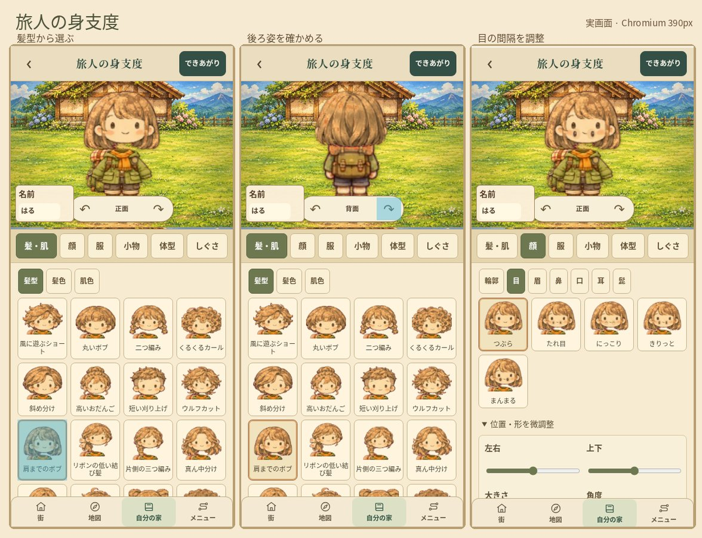
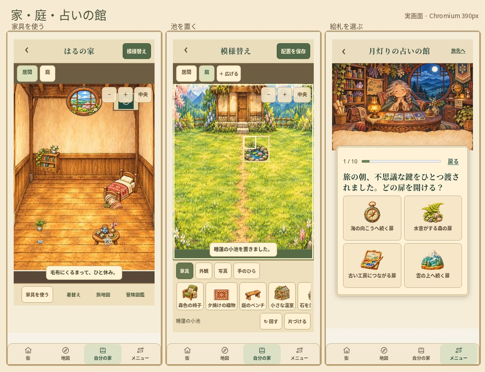

# 承認済み原画と見比べるゲーム画面

以下はアプリの実画面をスマートフォン幅390pxで撮影したものです。添付原画の該当部分と照らして確認できます。添付原画のファイル本体をこの比較資料に転載できる形では取得できなかったため、ここでは比較箇所を記載し、実画面のみ掲載します。

## 旅人の正面・背面・顔の調整

原画「旅人のカスタマイズ」の旅人全身と髪型の例、および「作ろう！デザイン準備リスト」のキャラクター例と見比べます。約2頭身、前髪の束、頬の色、襟元・ポケット・靴の描き込みを確認してください。髪型を変えたあとに回し、後頭部の髪とリュックも確認できます。右の画面は目の間隔を調整しているところです。

## 家具を使う・池を置く・占いの絵札を選ぶ

原画「自分の家と庭」の木部、織物、庭の木陰と水辺を見比べます。最初は床が広く空いており、家具を一つずつ置くと景色が変わります。居間では旅人がベッドまで歩いて眠ります。庭の模様替えでは、池の占有範囲が床の目印に沿って表示されます。右は占いの館で絵札を選ぶ画面です。

[試遊手順・素材数・制約](atelier-preview.md)
