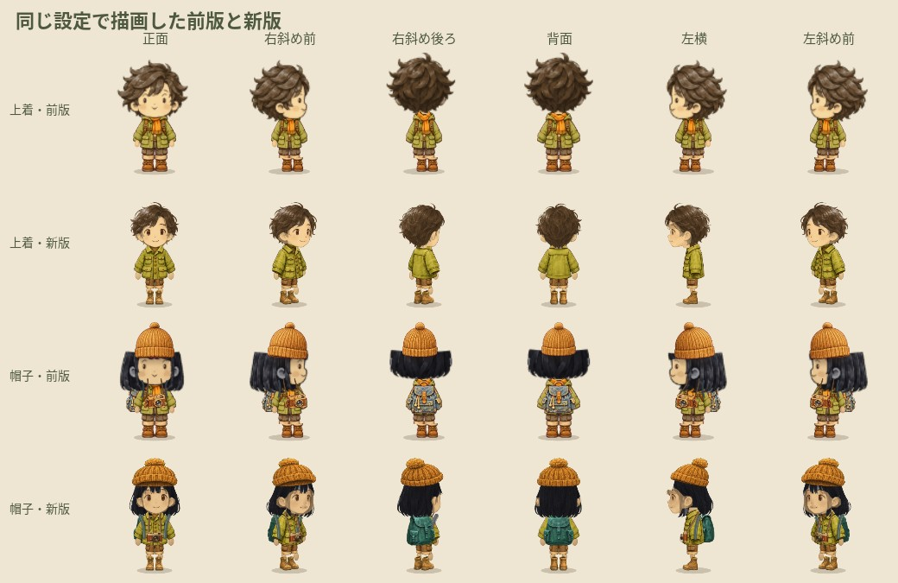
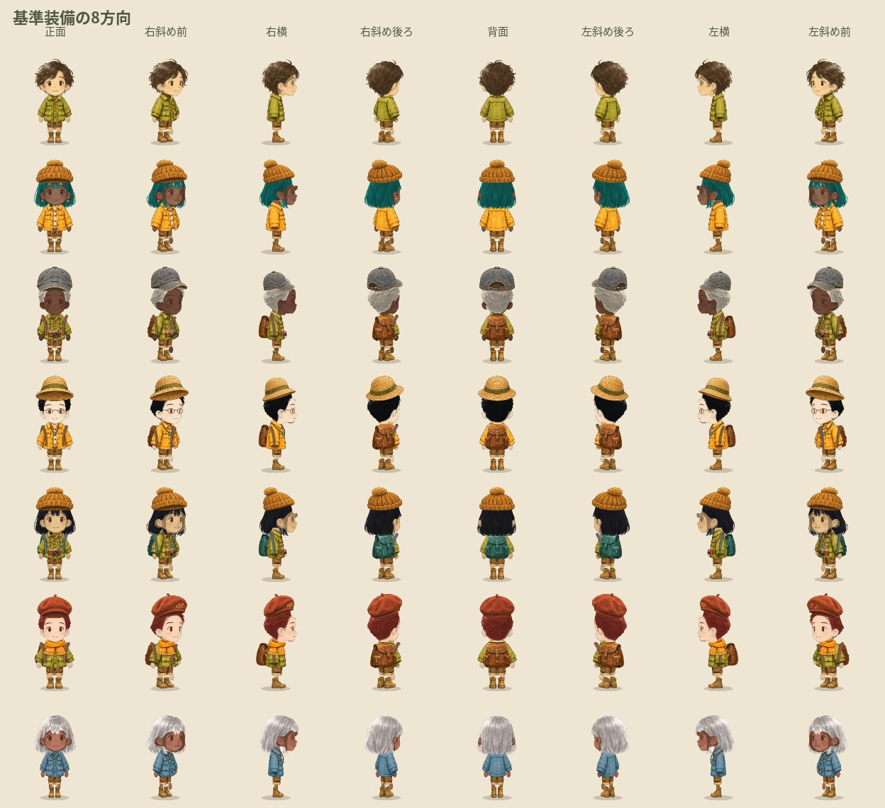
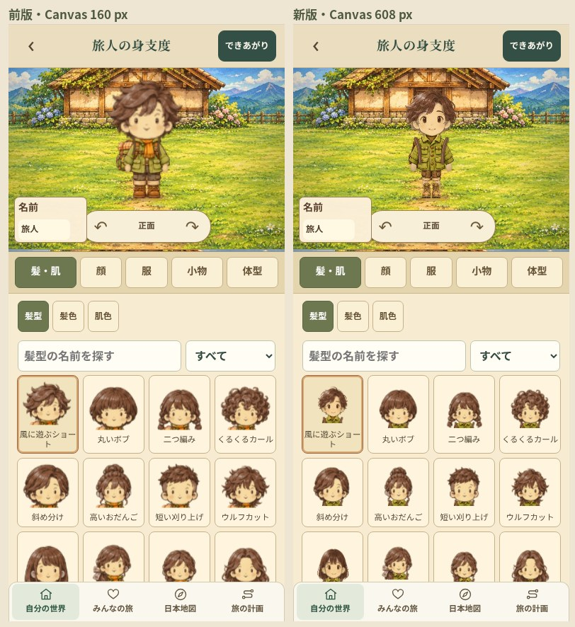

# 旅人の身体と装着品の描画規格

## 変更の対象

「風に遊ぶショート」「肩までのボブ」「後ろに流すショート」と、「旅の上着」「山吹の作業着」を新規の基準素材へ差し替えた。既存の名前と保存IDを使用する。髪型や衣装の収録数は髪24種類、衣装16種類。着せ替え、家、絵日記は同じ絵の合成を使う。

| 基準素材 | 原画と描画 |
| --- | --- |
| 髪・肌 | 3髪型×5方向の15コマ。前に出る髪、地肌と耳、後ろに落ちる髪、元の表情の線を別に扱う |
| 衣装 | 上着2種×5方向、ズボン1種×5方向。基準の首・袖口・足首に合わせ、首・手・脚の見える部分を身体側に置く |
| 装着品 | 帽子4種、共通の革鞄、既定の登山靴、カメラは各5方向の絵。眼鏡、肩紐、カメラのストラップ、ネックレスは基準点から描く。布の鞄は同じ形状で色味を変える |

旧版の「旅の上着」にはスカーフと肩紐が入り、向きによらず正面の衣装を利用していた。基準衣装の表面には着脱品を含めない。装着「なし」の場合は本体と紐の描画を省く。背中側の鞄は前からでは身体に隠れ、背面と斜め後ろからは面が見える。前から見える肩紐を袖口や顔から離し、胸に下がるカメラのストラップは襟から本体の金具へ結ぶ。眼鏡のつるは耳の位置につなぎ、横向きでは手前のレンズを描く。

## 制作規格

- **身体**は足底 y=116 の論理128単位を共通に使う。基準の上着は襟から裾まで35単位。頭部本体は髪を含め44〜46単位。全体は装着品を除いて約100〜104単位で、約2.3頭身に揃える。肩、腰、足首、手、胸、背中、首は各向きに座標を持たせる。体型の幅は衣装・装着品の寸法に適用し、頭部は顔の設定と微調整で操作する。
- **向き**は正面、右斜め前、右横、右斜め後ろ、背面の5方向を描く。左向きは形が左右対称のパーツを共通化する。ベレーの左面には刺繍を映さず、別の画像を切り出す。既存素材で絵を揃えられない角度は選択肢から省く。正面の絵しかない旧衣装には「正面のみ」を表示する。
- **画質**は元の絵から切り出した256pxセルを使い、透明境界を調整してWebPで収録する。元の画像を拡大してセルを埋める処理は行わない。髪・肌の輪郭を素材側で管理し、肌色が変わっても塗りの細部と陰影を残す。着せ替えはCSS上の寸法にDPRを掛け、DPR 3と768pxを上限とする。家は256pxの作業Canvasで合成したものを必要なサイズへ縮小する。
- **構成**は `public/avatar-frame.js` に共通座標と表示できる角度、`public/reference-art.js` に分離したレイヤーと装着処理、`public/reference-guides.js` に原画の切り出し位置を置く。制作時は `scripts/pack-reference-rig.py` に頭、衣装、装着品、帽子の原画を渡す。透過色と部位の境界を処理し、ブラウザー内では髪・肌・衣装の色を明るさに沿って置き換える。服の裏地などは元の色を残す。
- **素材**は本プロジェクト向けに作成した生成素材。利用者提供の原画を絵柄の基準にし、既存ゲームの素材や公式ロゴを使わずに制作した。過去の旅行写真や画面素材の出典は旧版の台帳に保管。 [従来の作画と素材台帳](rpg-art.md)

## 視覚検証

Chromiumの390 CSS px幅・DPR 3で、同じ約203 CSS pxの表示に割り当てる着せ替えCanvasが160pxから608pxに増えたことを計測した。帽子を含めた頭頂から靴までを8方向で見比べ、耳の間を横切る着色、ニット帽の見切れ、脚の外側に見えていた肌、眼鏡の重複を修正した。検証用の自動テストでは基準40組と既存の148組を描画し、鞄とカメラの着脱、背面での遮蔽、旧衣装の角度制限も確認した。自動テストは38件。Android実機はこの版の公開後に確認が必要。

## 残っている作画

全24種の髪型と全16種の衣装を、この規格で描き直す作業は今後の対象。基準の5原画以外は、利用できる角度に限って表示する。髪型の非対称な分け目や光の向きに左右それぞれの専用原画が必要なケースがある。別売りの靴も斜め後ろの原画が揃うまでその角度を省く。

前髪・後ろ髪と顔のレイヤーは分離した。耳を個別に差し替える絵、衣装ごとに独立した腕・脚の可動素材、トップス・ボトムス・アウターを自由に組み合わせる編集、全方向の専用の歩行・生活アニメーションは未完成。基準セットの着脱と角度を先に検証し、旅の機能と保存した外見を同じデータで利用できるようにした。
