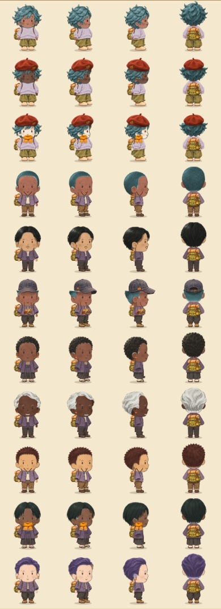
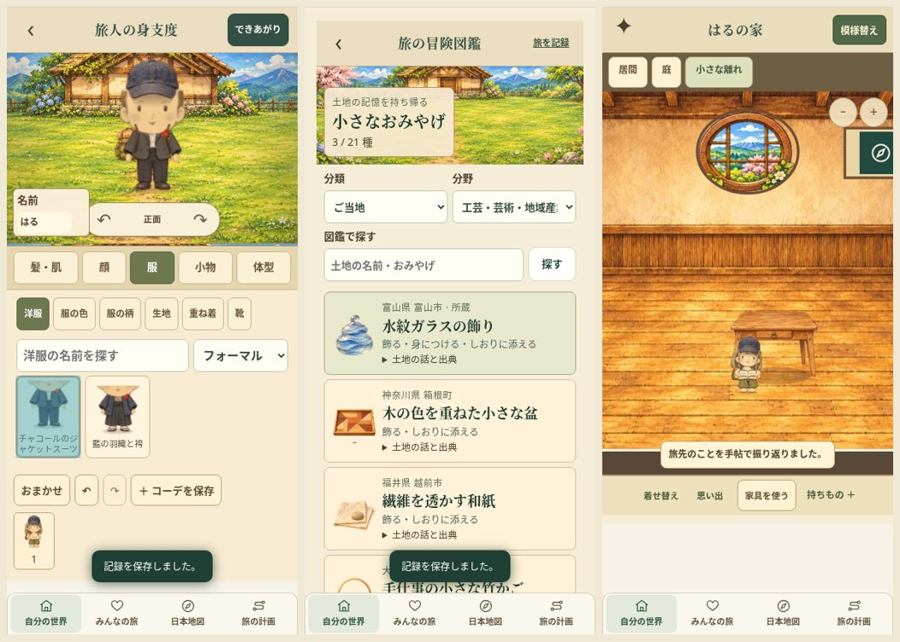

# 髪・肌・衣装と旅のコレクション

## プレビューで試せること

- **自分の世界 → 着せ替え**で髪・肌の色を選び、回転ボタンで耳、前髪や帽子のつばを見比べる。「髪型」「洋服」は名前と分類で絞り込める。フォーマルにはスーツと羽織がある。
- **自分の世界 → 模様替え**で旅机とロッキングチェアを置く。庭にはあじさいの鉢と小さな水鉢を置ける。配置と回転に家具ごとの足元と占有マスを使う。
- **自分の世界 → 持ちもの → 冒険図鑑**で「ご当地」と分野を選び、土地の話と出典を開く。例えば、富山でガラス美術館を訪ねた体験を記録すると、水紋ガラスの飾りを持ち帰れる。対象品は家に飾るか、絵日記から作る旅のしおりに添えられる。
- 家で旅人をタップすると短い言葉を返す。「やってみよう」「ありがとう」「なんとかなる」「ありのままに」をもとにした4つの台詞を使う。気分の推定や外部への送信は伴わない。

## 収録数

| 分類 | 収録数 | 今回の追加 |
| --- | --- | --- |
| 髪型 | 24 | 坊主、短めのセンターパート、ツーブロック、細かなカール、クルーカット、生え際の高いウェーブ、前髪を長めに流すショート、後ろに流すショート |
| 色と顔 | 髪色50＋任意の色、肌色20、輪郭4、目5、眉3、鼻3、口4、髭5 | 銀白の髪色1色、髭2形状 |
| 衣装 | 16 | 街歩きのオーバーシャツ、チャコールのジャケットスーツ、キルトの仕事着、藍の羽織と袴 |
| 帽子・眼鏡・靴・バッグ・基本の小物 | 4・4・3・2・5 | 小さな石のネックレス1点 |
| ご当地 | 21 | 富山市のガラス、高野山の伝承、出雲の玉作、箱根寄木、越前和紙、別府竹細工、高岡銅器、木曽漆器、宇治の茶文化を題材にした9点 |
| 家具・道具、植物・庭、思い出 | 12・9・10 | 旅机、ロッキングチェア、あじさいの鉢、小さな水鉢の4点 |
| 勲章と称号 | 獲得可能15種、うち隠し6種 | 工芸との出会い、工芸の収集、土地の昔話、地質の4種。地域提案の採用と実際のおとも旅に対応する定義2件は試遊から付与しない |

色、左右反転、方向ごとのコマ、「なし」、靴の自動切替は形の数に含めない。図鑑の件数には既存の絵を複数の品が共有する項目を含む。

## 作画と合成

1. 承認済み原画のマットな絵本調を基準とする。素材は128×128pxの透明セルで、旅人の足元を y=116、目線を首の基準から11px上に揃える。新規の髪と衣装は正面・斜め・横・背面を個別に用意する。反対側には鏡映、背面斜めには背面の補正を使う。細い輪郭、抑えた彩度、上からの柔らかな光を揃える。
2. 髪、肌、生地の被覆率を損失なしの素材マップに記録する。新作の生え際と耳は方向別の輪郭を指定し、旧作は肌の明暗と輪郭から塗り分け、必要な箇所に輪郭を追記できる。元の目・眉・口を肌の面で取り除き、選んだパーツを同じ肌の面で切り抜いて描く。境界の半透明を維持し、全面が覆われた画素には元の色を混ぜない。明暗は元の絵を参照する。耳・首・袖から見える手にも同じ肌の選択を参照する。
3. 帽子の前後とつば下の影、眼鏡のつる、リュックの肩ひもは既存の方向別の装着情報を使う。イヤリングは見えている耳の位置へ寄せ、スカーフとネックレスは首元の接触位置で描く。既存素材の一部と背面斜めには方向別の描き足しが必要。服は上下セットで、一部の既存の縁取りにも色がかかる。
4. `scripts/pack-atelier.py --cell-source` で透明セルに整形し、`scripts/prepare-materials.py` で素材マップと描画位置を更新する。生成には Pillow、NumPy、SciPy を使う。制作時にセルの余白と肌面積を確認し、ブラウザーでは頭頂、額、正面・背面の耳、服の裏地と表地の役割を画素単位で確認する。

新規の絵は本プロジェクト用に作成した生成素材。公式ロゴや商品のパッケージを使用していない。9点の地域情報は自治体、文化施設、寺院、工芸の紹介機関の記述を参照し、2026年11月26日を確認日として記録した。高野山の話を伝承、出雲玉作跡などを地域資料にもとづく説明、各アイテムの造形を創作と記載し、図鑑で個別に出典を開ける。 [地域資料の一覧](../public/local-crafts.js) · [既存素材の台帳](rpg-art.md)

## 拡張と互換性

髪型や衣装には変更しないIDを割り当てた。保存されたIDを優先し、以前のコーデの数値も同じ項目として読む。家具、ご当地、着用、しおりの添付は同じ品のIDを参照し、地域品には地域名、場所と照合用の別名、体験条件、分野、由来、創作の説明、出典、確認日と用途を持たせる。勲章の多くは確認済みの現実の記録を参照し、受け取った品や勲章に期限はない。

着せ替えと図鑑は最大12件ずつ描画する。追加の作画は必要なシートだけを読み、PWAが画像の内容に対応するハッシュを使って最大48ファイルを保存する。初めて選んだ作画が未取得のままオフラインに入ると、保存されたコーデを保ったまま基本の作画へ一時的に切り替わる。数万件の運用には索引の分割と配信、スマートフォンでの計測が必要。

## 確認結果と残り

- 自動テスト37件。Chromiumの320・390・768・1280pxの表示と計148組の旅人描画、分類と保存、タッチでの模様替えとピンチ、図鑑としおり、富山の検索と地図、アプリ更新後の保存とオフラインを確認。
- Android実機は今回の更新後には未確認。公開する動きは既存の立ち姿とまばたき、歩行、喜び、読書を使用。保管中の動き、入浴や睡眠の新規作画、時刻・季節・位置に合わせた生活、年齢固有の体格、上下やアウターの独立着用は今後の対象。
- 全国での自動獲得、遠隔のおとも報酬、地域提案の採用、数万件の負荷試験は今後の対象。

