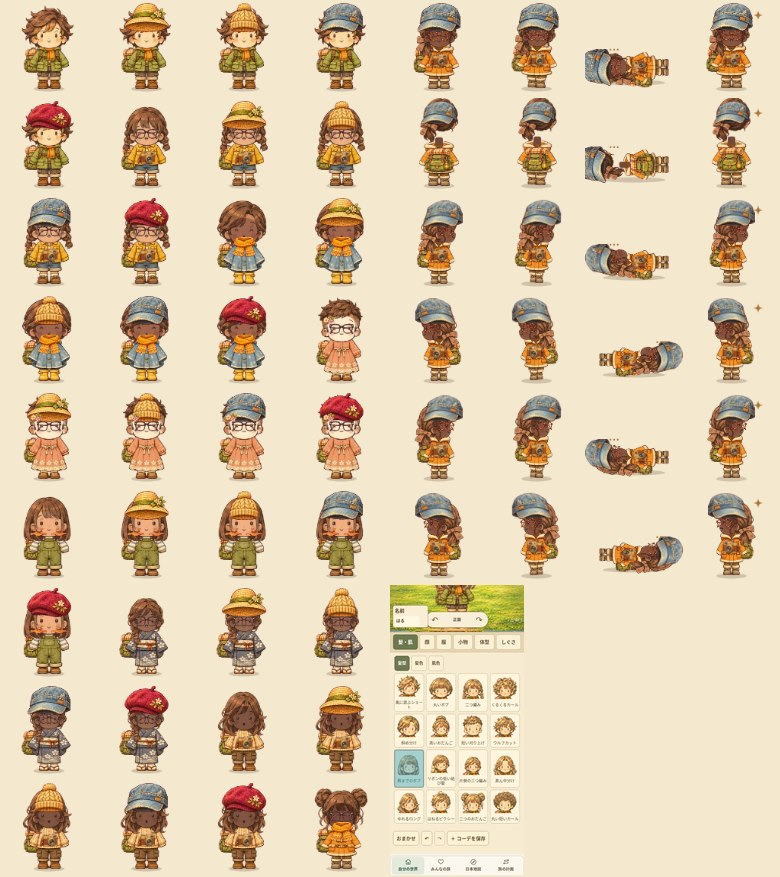
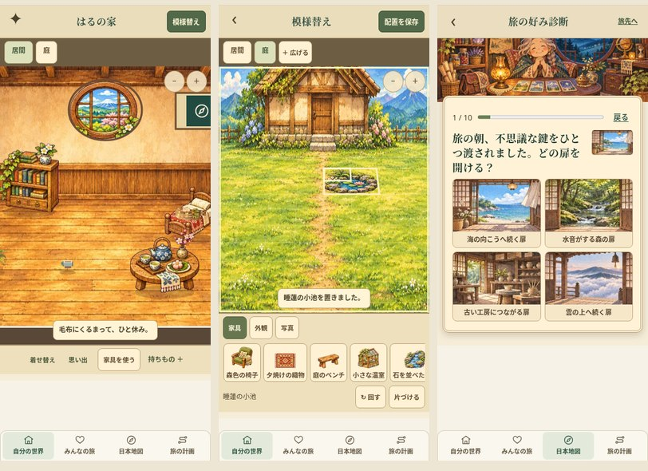
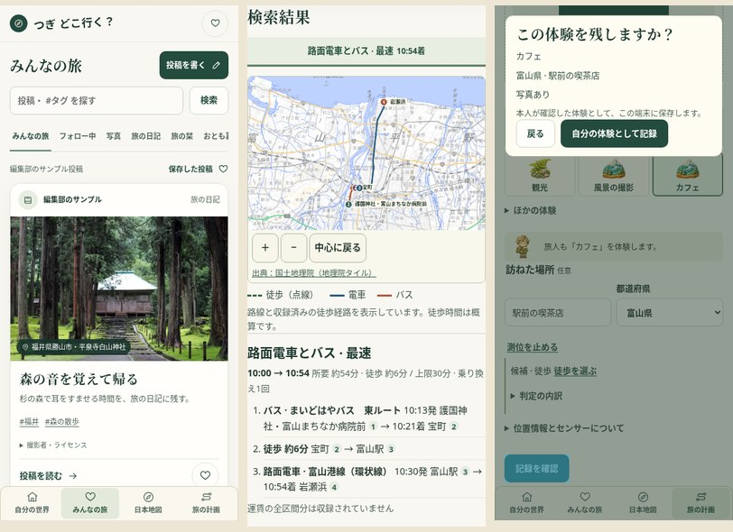

# 自分の世界と旅の世界

Androidから届いた画面をもとに、表示と操作を見直した。下部は「自分の世界」「みんなの旅」「日本地図」「旅の計画」の4項目。街の旧URLと作画は保管する。保存データのキー、ID、ストレージは継続使用する。

- 自分の世界では着せ替えと模様替えを直接開ける。旅の記念品、勲章、旅コイン、お知らせは「持ちもの」から開く。床をタップすると旅人が歩き、家具の近くでは家具を使う。
- みんなの旅は写真と旅日記を先に表示する。おとも募集は同じ投稿切り替えから開く。現在は編集部のサンプルと端末内の試遊。
- 日本地図は「訪問済み」「行きたい場所」「旅の記録」を切り替える。訪問済みは本人の過去の記録とGPS確認を参照する。絵日記は入力した都道府県、通常の日記は地名から都道府県を特定できるものを表示する。仮想散策の印はスタンプ帳で区別して残る。
- 旅の計画から富山の実ダイヤによる経路検索、しおり、自分の旅日記、体験の絵日記を開く。富山は点線の徒歩、青い路面電車、赤いバスを同じ地図で表示する。地図上の番号は時刻の一覧と対応する。経路の形状が未収録の区間は両端の地点で示し、徒歩時間は概算として表示する。検索対象と用いた日付・出典は以前の試作を引き継ぐ。[富山の交通データ](toyama-pilot.md)
- 旅を記録するときは写真、体験の絵、場所を選び、一度確認してから保存する。位置情報は任意。生の座標は保存せず、候補の確信度と理由は開いたときに表示する。思い出が家に届くと旅人が喜ぶ。
- 地図から開く任意の「旅の好み診断」は、10問・40枚の選択肢の絵に整理した。32問版の回答はそのまま読み込み、以前の結果も見られる。絵札は本プロジェクト用に画像生成した創作の風景。既存の写真・出典は引き継いだ。

## 旅人の合成基準

128×128の論理キャンバス、足元 (64,116)、首の中心、首から11px上の目線を原点に使う。服と靴を足元と脚の境界に合わせ、首を中心に顔を配置する。正面と側面の頭部から旧作画の目・口を除去し、肌をマスクとして別管理する。絵の髪を残しつつ元のパーツが重ならないよう、目・眉・鼻・口を一つずつ肌の領域に描く。色を変えるときも肌の明暗を保持する。帽子・眼鏡は元画像の透明余白を除き、目線を基準に重ねる。背面は後ろ髪の別素材を使う。動作は同じ服、髪、肌、小物のレイヤーを共有する。

作画の素材は保管し、`scripts/prepare-avatar-layers.py` で素体・肌マスクと各素材の境界を生成する。画像の基本部分は以前の承認済み原画をもとに整えた本プロジェクト用の作画。髪と頭の陰影を保持するため、前髪・頬・耳が部分的に一体の素材。人物の横・後ろの服や家具の回転は2D素材を変形して表現している。各方向の描き下ろし衣装と帽子、手足の関節ごとの作画は今後の改善範囲。

## 家と庭

部屋の床に合わせて遠近法でタイルを投影し、画面のタップとドラッグを同じ座標に戻す。床置きの素材は透明余白を除いた接地端と影を基準に下から配置する。写真額と乗車券の額は壁面枠。回転で当たり判定を更新する。家具をつかんだ指は家具を動かし、背景のドラッグはカメラを動かす。2本指では家具の移動をキャンセルしてピンチに切り替える。古い家具の配置座標は保持する。

試遊と写真出典の詳細は [素材台帳](rpg-art.md)・[写真台帳](photo-credits.md) を参照。

## Androidで古い画面が開いたとき

同じプレビューURLをオンラインで開き直す。画面下が「自分の世界」「みんなの旅」「日本地図」「旅の計画」なら、この改修版が開いている。新しい版の読み込みが終わると「最新版を表示」が出る。編集中は「あとで」を選び、保存してから開き直せる。保存済みの旅の記録は同じブラウザーに残る。アプリの更新にブラウザーのデータ消去は不要。

## 検証

31件の自動テストを実行。Chromiumで320・390・768・1280pxを確認し、タッチの家具移動とピンチ、記録確認、地図のレイヤー切り替え、経路候補の切り替え、オフラインを試した。肌色・帽子・服を変えた40組と、8方向での4動作の32組を描画した。実データの経路と国土地理院のタイルを合わせて表示した。添付のAndroid画面は不具合の再現条件に使用した。更新後のAndroid実機は未検証。

