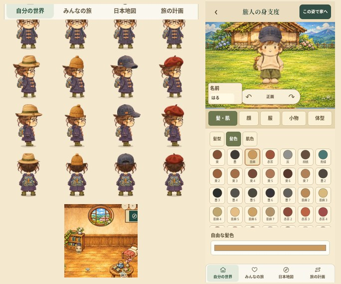

# 旅人の身支度とコレクション

## 今回の収録数

| 項目 | プレビューで選べるもの |
| --- | --- |
| 衣装 | 12種。街角のカーディガン、海辺の刺しゅうシャツ、長い街歩きコート、木綿の部屋着の4種が新規。上下は衣装として一緒に選ぶ |
| 帽子 | 4種。山歩き帽、ニット帽、キャップ、ベレーを描き直し、各4方向の原画を使う |
| 靴 | 3種。帆布靴、赤いストラップ靴、長靴。服に合わせる設定は数に含めない |
| 眼鏡、バッグ、基本の小物 | それぞれ4種、2種、4種。眼鏡のつる、肩ベルト、カメラのひもを身体に合わせ直した |
| 髪と顔 | 髪型16、輪郭4、目5、眉3、鼻3、口4。眉なしと色替えは形の数に含めない |
| 生活の描画 | 立ち姿とまばたき、歩く、喜ぶ、読書の4系統。公開設定は着せ替え画面から外し、家や旅に割り当てている |
| ご当地の記念品 | 12種。伊豆大島、黒部峡谷、奈良の工芸、雲仙の湯けむりを4件追加 |
| 家具・道具、植物・庭、思い出 | 10、7、10の登録。各図鑑項目の分類。対応する絵を共有する品を含む |
| 勲章と称号 | 11種をこの版で獲得可。うち隠し3種。別に地域提案採用と実際のおとも旅の定義を各1種保管 |

帽子や服の複数方向の絵、既存の色調整は種類数に含めていない。姿勢の調整、写真と旅の記録、スタンプ、既存のコーデは引き継ぐ。

## 絵と合成の基準

128pxセルの足元は y=116。服の襟を首の基準とし、首から上11pxが目線。前向き、右斜め、右向き、後ろ向きの原画を用意し、反対側は鏡映する。後ろ斜めは背面原画に位置と幅の補正を使う。

帽子には種類・向き別の座りとつばの中心を持たせた。つばの奥、髪の遮蔽、髪に落ちる影、つばとクラウンの手前の順に合成する。眼鏡の横向きは片レンズとつるを使う。歩行は支持脚と振り出し脚を切り替え、足首と服の裾を重ねる。読書では家具に近づいて立ち止まったあと、指で支えた本のページが動く。動きを減らす設定では静止画で表示する。全身の回転で表現していた睡眠や、小物を前に出すだけの飲食・撮影などは、今後の作画に備え素材と[従来の描画コード](https://github.com/balletkazu/tsugi-doko-iku/blob/d1924af214ecc6b54f3166abeadf3355975bf591/public/traveler-art.js)を保管し、公開場面では落ち着いた立ち姿にした。

新作画は本プロジェクト用の画像生成素材。公式ロゴ・既製品の絵は使っていない。透明WebPへの変換は `scripts/pack-atelier.py`、各コマの境界測定は `scripts/prepare-avatar-layers.py`。従来素材を含む出典は[素材台帳](rpg-art.md)。地域の事実と創作した記念品の説明は図鑑で分けている。[伊豆大島ジオパーク](https://izuoshima-geo.org/know/highlights/ecologicalsite/ecosite-4.html) · [黒部・宇奈月温泉観光局](https://www.kurobe-unazuki.jp/tourism/440/) · [奈良県](https://www.pref.nara.lg.jp/n101/1382.html) · [雲仙観光局](https://unzenonsen.unzen.org/watch/jigoku/)

## 素材を追加するとき

- 衣装は `public/style-catalog.js` で、変更しないID、名前、分類、画像シートとセルを管理する。保存時には安定したIDと過去の数値の両方を記録する。旧記録の番号は同じ項目を指す。検索・分類後、絵の一覧は最大12件ずつ表示する。色の見本は絵の一覧と分けている。
- `public/item-catalog.js` で、同じIDに獲得元、図鑑、飾る面と広さ、着用の可否をまとめる。例えば大島椿のピンは、伊豆大島の体験から得て、図鑑で読み、家に飾り、身につけられる。図鑑は分類・地域名・品名で絞って12件ずつ表示する。
- 勲章の条件は `public/medals.js` に集約した。自分で保存した現実の体験を参照し、獲得した旅の勲章は恒久的に保持する。隠し勲章は獲得前に表示しない。受け取った勲章は称号にも使える。地域貢献は編集部の採用、おとも旅は実際の同行の記録が必要。端末での下書きや試遊だけでは付与しない。

既存8種の衣装の背面と斜めは一部の絵を補正して表示する。手足の各関節をすべて個別の絵にしたフルリグ、上下の独立着用、生活と現実の時刻・季節・位置の連動は未実装。1,000件以上を配信する際は素材シートとオフラインの先読み対象を分割し、端末での負荷を測る。

## 検証

自動テスト34件。Chromiumで320・390・768・1280pxの表示、各方向の帽子と靴など104組、4系統の公開動作、衣装の検索・分類と旧コーデ、旅の記録から記念品の獲得・図鑑・配置・着用まで、隠し勲章と称号、旧版からの更新とオフラインを確認。富山の経路検索と地図の検証も継続した。更新後のAndroid実機は未検証。

